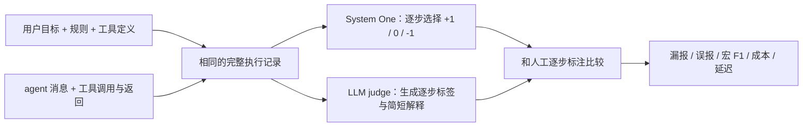

# System One 究竟如何评估 Agent？

> 本文为已完成的 AgentProcessBench 子集实验，不是 BFCL / τ² 官方全量成绩。新的主实验选型见[数据集选择与实验设计](benchmark-selection.md)。

## 先用一句话说清楚

**把 agent 做过的事情交给一个“检查员”，让它逐步判断行为是否正确，再检查任务是否完成。System One 和 LLM-as-judge 是实现这个检查员的两种方式。** 它们不会因为被称为 judge 就自动知道工具实际发生了什么；判断必须依赖任务约束、工具返回、环境状态等证据。

原来的 JudgeBench / RewardBench 2 实验主要评“回答质量”。此前的外部结果复算和小型合成探针补充了机制诊断，但都不足以回答“它能否看懂真实 agent 的执行过程”。本页将新的真实轨迹实验作为主线，旧实验保留在历史报告中。

## 1. 它到底看什么、判断什么？

以“修改航班并按规则支付”为例：输入包括用户要求、航空业务规则、可用工具、agent 每次的工具调用和工具返回。评委需要识别：是否拿对订单、是否满足改签条件、是否征得确认、支付金额是否对得上、最后的成功声明有没有依据。



这里区分三个问题：

- **结果评估**：任务最终完成了吗？最好优先用可执行验证器检查数据库、文件、测试、订单等真实状态；无法程序化验证时再使用模型评委。
- **过程评估**：哪一步出错、是合理探索还是无效重复、后面的步骤有没有受到错误影响？本轮主实验测这个能力，也附带测最终成败判断。
- **改善 agent**：用检查结果触发纠错、重试或转交后，任务成功率是否提高？这需要另外跑闭环对照实验，本轮静态轨迹评估不能代替它。

## 2. 相较于 LLM-as-judge，有什么区别？

System One 在这里指直接产生类型化判定的决策模型，不是统一的标准架构名称，也不意味着所有模型都同样快或可靠。[Jev 官方接口](https://docs.typesafe.ai/introduction)以状态与预定义问题为输入，返回类别、概率等值；[Clef-flash 模型卡](https://huggingface.co/cloudflare/clef-flash)描述了另一种结构化决策实现。本轮两个模型均实际调用，并非仅引用宣传指标。

| 维度 | System One 决策评委 | 生成式 LLM judge |
|---|---|---|
| 同一个输入 | 任务、约束、工具定义、执行轨迹 | 完全相同的任务和执行证据 |
| 本轮输出方式 | 每一步在“正确推进 / 中性探索 / 错误”中选择，并返回类别概率 | 自回归生成 JSON 标签和简短证据解释 |
| 如何提出评估问题 | 先在代码中定义要检查的类别 / 维度 | 在提示中定义评分规则与输出格式 |
| 长处应怎样验证 | 类型合法率、批量判定成本、延迟、错误识别能力 | 多步依赖判断、解释的可核查性、错误识别能力 |
| 不能默认成立的事 | 概率高不等于正确；类型合法不等于语义正确 | 解释流畅不等于有证据；JSON 合法不等于正确 |
| 适用方向 | 可明确界定的证据检查、分诊、批量回归监控 | 较复杂的冲突审查、疑难失败分析、需要文字说明的复核 |

**两者都可以实现 judge。真正差别是判定如何计算和输出，以及实测的质量—费用—延迟权衡，不是“一种会评 agent，另一种不会”。** 给 LLM 加 JSON Schema 只改变输出约束，并不会把它变成直接决策模型。本轮不要求 LLM 输出冗长推理，而是生成短解释；仍然属于生成式评委。

更细粒度的 System One 设计可以把“这一步是否有效”拆为“参数是否符合 schema、是否满足授权条件、成功声明是否有工具证据”等独立检查，再由代码汇总。但拆解需要相应人工标注，不能拿本轮三分类结果声称这些子能力都已验证。

## 3. 这次具体做了什么实验？

使用 [AgentProcessBench 数据集](https://huggingface.co/datasets/LulaCola/AgentProcessBench)的 **BFCL 与 τ² 两个完整子集**：各 250 条轨迹，共 500 条、6,147 个有人工标签的步骤。它们分别覆盖多轮工具调用与业务交互。数据来自公开 agent 基准的运行轨迹；采用 AgentProcessBench 的人工过程标注，不将底层环境自动成功分数误当人工标签。

[论文](https://arxiv.org/abs/2603.14465)完整数据集还有 GAIA 和 HotpotQA，总计 1,000 条轨迹、8,509 个步骤。本轮按工具使用与业务办理的任务范围选择两个子集，**不是完整 APB 排行榜复现，也不是重新运行 BFCL / τ² 的被测 agent**。

具体操作：

1. 固定源数据版本，保留两个子集的全部轨迹；每个底层问题有五条轨迹，共 100 个问题。
2. 从每条轨迹取任务要求、规则、工具定义、完整消息与消息编号；不传人工标签、参考答案、`tool_metrics` 或独立的 `answer_text` 字段。
3. 三个评委看到同样的执行证据和相同语义的评分规则。Jev / Clef 输出固定类别；GPT-5 mini 生成标签及简短解释。
4. 为每条 assistant 消息标记：**+1 正确并推进任务；0 合理探索或中性；−1 错误或有害**。遵循 APB 的错误传播规则：依赖未纠正错误的后续步骤也受罚；纠正或独立恢复后可解除。
5. 与人工标签逐项对照。主指标为三类宏 F1，附带逐步准确率、错误召回、错误误报率、最终成败准确率、费用和每条轨迹延迟。
6. 对同一批问题做配对比较；置信区间按底层问题聚类，保留五条相关轨迹，不能把 6,147 个步骤当成独立任务。

原始完整轨迹离线可见，但评分规则要求按照当时可知的信息判断每一步；这仍然可能有后见偏差。未来若要在 agent 正在执行时使用，需要只提供前缀轨迹重新验证。当前不能声称已证明线上拦截有效。

完整方法与失败计数规则见 [预先固定的协议](../artifacts/agentprocessbench/PROTOCOL.md)，所有请求的证据与内容哈希见 [manifest](../artifacts/agentprocessbench/manifest.json)。

<!-- RESULTS -->
## 4. 实测结果：谁更会评，差距在哪里？

**本轮 Jev 的过程判断最好、延迟也最低；但三个评委都漏掉大量错误，不能据此作为唯一错误拦截器。** 这是指定模型版本、提示、任务范围下的结果，不能推广为 System One 架构普遍优于所有 LLM。

### 4.1 过程判断：主结果

总计 1,680 个错误步骤、231 个中性步骤、4,236 个正向步骤。始终猜 +1 已有 68.91% 准确率，因此必须同时看三类宏 F1 和错误召回。缺失输出按错计入主结果。

| 评委 | 完整轨迹输出 | 宏 F1 | 逐步准确率 | 错误召回 ↑ | 正常/中性步骤误报率 ↓ |
|---|---:|---:|---:|---:|---:|
| Jev 1.14 | 500/500 | 50.45% | 77.13% | 34.35% | 2.22% |
| Clef-flash | 497/500 | 42.45% | 66.15% | 16.79% | 2.08% |
| GPT-5 mini | 500/500 | 37.57% | 71.22% | 13.45% | 1.32% |
| 始终判 +1 | 500/500 | 27.20% | 68.91% | 0.00% | 0.00% |

Jev 相对 GPT-5 mini 的宏 F1 高 **12.88 个百分点**，按 100 个底层问题进行 2,000 次配对 bootstrap 的 95% 区间为 **[9.10, 16.41] 个百分点**。Jev 本身宏 F1 的区间为 [47.60%, 53.25%]。这说明本轮差距并非仅凭一个案例得出，但不消除提示配置、数据污染和任务范围限制。

实际含义：每 100 个已标注错误，Jev 约发现 34 个，仍漏掉约 66 个。较低误报率不能弥补如此高的漏报。Clef 的宏 F1 高于 GPT，但总准确率更低，也说明一个总准确率不足以比较三分类评委。

| 子集 | Jev 宏 F1 | Clef 宏 F1 | GPT-5 mini 宏 F1 |
|---|---:|---:|---:|
| bfcl | 47.02% | 40.45% | 40.33% |
| tau2 | 52.05% | 43.29% | 35.99% |

**覆盖率敏感性检查（事后补充）**：只比较三个模型均完整返回的 497 条轨迹 / 5,883 个步骤，Jev、Clef、GPT 的宏 F1 分别为 49.20%、43.72%、39.23%，顺序不变。该表只帮助区分接口失败与判断能力，不替代包含失败的主结果。

### 4.2 最终结果、费用和耗时

| 评委 | 最终成败准确率（480 条） | 识别最终失败的召回 | 全部请求报告费用 USD | 每条轨迹 p50 / p95 秒 |
|---|---:|---:|---:|---:|
| Jev 1.14 | 76.04% | 69.55% | $0.3414 | 0.57 / 0.73 |
| Clef-flash | 58.96% | 36.47% | $0.1764 | 1.12 / 1.99 |
| GPT-5 mini | 64.17% | 38.35% | $2.3014 | 8.93 / 17.48 |

**口径修正必须说明**：分析时发现源数据有 20 条 `final_label=0`，但官方评委提示及本轮沿用的终局输出只有 ±1。因此辅助终局二分类指标使用其余 480 条；不把 0 擅自改成成功或失败。所有 500 条的逐步标签仍完整纳入主指标。全 500 条终局精确匹配率也保留在 JSON 中：Jev / Clef / GPT 为 73.00% / 56.60% / 61.60%。这是事后发现并披露的协议与标签差异，不是事先选掉困难样本。

三模型主实验总报告费用 **$2.8192**，不含单独的预检。费用计入有 usage 的失败 / 重试响应；没有 usage 的失败是否收费未知。延迟包含分批和重试，不包括线程排队；并发为 12，并非硬件归一化吞吐。本轮 GPT 使用 low reasoning 与短解释，不能由此推断更强模型或更大推理预算的表现。

### 4.3 真实案例：工具成功不等于任务成功

来自 `bfcl:0:0`，原始证据见 [cases.json](../artifacts/agentprocessbench/cases.json)：

- 用户要求：在 `workspace` 里面创建 `Projects`。
- 工具 `pwd` 返回当前目录 `/alex`。agent 随后直接调用 `mkdir(dir_name="Projects")`，没有先进入 `workspace`。
- `ls` 显示 `workspace` 与 `Projects` 并列，因此目录位置不符合要求。agent 随后仍向用户宣称创建成功。

| 被检查步骤（原消息编号） | 人工标签 | Jev | Clef | GPT |
|---|---:|---:|---:|---:|
| 5：在当前目录直接创建 Projects | −1 | −1 | +1 | +1 |
| 9：对用户宣称创建成功 | −1 | +1 | +1 | +1 |

评委需要比较的是“执行结果是否满足要求”，不能只看到调用成功就给高分。这个案例中 Jev 识别了路径错误，却也没有把问题稳定反映到后续成功声明。案例为事后选择的解释示例；排名来自完整集合，不由这个案例决定。

概率同样不保证正确：Jev 最大类别概率 ≥0.9 的 3060 个步骤中，仍有 8.37% 与人工标签不一致；Clef 对应 1969 个步骤的不一致率为 14.37%。这只是该子集的描述统计，不等于完成了概率校准或阈值选型。

### 4.4 实验是否跑完？有没有运行错误？

**已按固定协议结束全部 1,500 份提交，完整输出 1,497 份。没有仍在后台等待的实验。** 共计划 18,441 个步骤标签，264 个因 Clef 三条终止失败而缺失；它们在主结果中按错计。

- 预检：Clef 一次 96 个问题被拒绝（上限 64），修正为分批请求；全量证据保持不变。预检不计入主指标。
- 正式 Clef：7 条轨迹出现合计 16 次 HTTP 422 token-limit 拒绝；4 条经重试完成，`tau2:35:4`、`tau2:44:4`、`tau2:48:4` 在最多三次尝试后仍失败。预检曾接受同一最长轨迹，正式服务仍可能拒绝，不能靠一次 smoke 宣称覆盖所有长度。
- 正式 GPT：7 条轨迹出现合计 9 次漏 / 多步骤编号的输出校验错误，重试后全部完成。没有悄悄补造缺失标签；原始响应保留。
- Jev：500 条均在首次轨迹尝试完整返回。此处仅说明接口 / 输出可用性，不等于标签全对。
- 除上述接口与输出问题，分析还发现了终局标签 0 与二分类提示的口径差异，已按上一节披露。
- 缓存已验证：再次运行主实验显示 `Pending 0`；不会为终止失败自动超出三次尝试，也不会重复计费。

原始响应、所有重试、模型返回版本与逐项预测均保存在仓库。数据审计 / 标签映射 / 缺失计分等 11 个测试通过。
<!-- /RESULTS -->

## 5. 如何发展通用的 Agent 评估？

建立三层评估，而不是把单个“总分 judge”放在所有任务后面：

1. **环境事实层**：能程序检查的状态先检查，例如测试退出码、文件内容、订单字段和权限变更。把“真实任务是否完成”与“agent 自称完成”分开记录。
2. **过程评委层**：用人工标注的真实失败与正常探索轨迹，验证证据检查和错误定位能力。System One 是候选实现之一，LLM 是另一候选；按漏报、误报、成本一起选型。不要用格式正确率代替评估有效性。
3. **复核与闭环层**：疑难和冲突案例转交较强评委 / 人工；抽查被自动放行的案例，以发现高置信漏报。接入 agent 后另做 A/B：相同任务与预算，比较任务成功率、错误副作用、恢复率和总延迟。

阈值和转交规则应在独立校准集上选择，再在冻结测试集评估。后续数据按工具环境 / 任务家族隔离，并加入更长轨迹、合理工具失败、部分成功、规则冲突和注入式工具输出。本轮既没有训练评委，也没有验证概率校准或“转交策略提升成功率”；这些需要独立实验，不能由较低 API 费用推导。

## 6. 如何复核和复现？

- [源数据](../data/agentprocessbench/)与 [下载脚本](../scripts/prepare_agentprocessbench.py)：固定 Hugging Face revision 与 SHA-256。
- [推理脚本](../scripts/run_agentprocessbench.py)：按请求哈希断点续跑，保留接口失败，不把缺失结果当成功。
- [原始响应](../artifacts/agentprocessbench/results.jsonl)、[逐步对照 CSV](../artifacts/agentprocessbench/per-step.csv)、[汇总指标](../artifacts/agentprocessbench/metrics.json)。
- [分析脚本](../scripts/analyze_agentprocessbench.py)：不需要密钥，可重算全部指标与配对区间。
- [一页 PPT](jev-eval-lab-one-page.pptx) / [PDF](jev-eval-lab-one-page.pdf)。

```bash
.venv/bin/python scripts/prepare_agentprocessbench.py
.venv/bin/python scripts/run_agentprocessbench.py --prepare
.venv/bin/python scripts/run_agentprocessbench.py --smoke
.venv/bin/python scripts/run_agentprocessbench.py --run
.venv/bin/python scripts/analyze_agentprocessbench.py
```

推理需要已配置的 OpenRouter 密钥并产生费用；已有结果可直接离线分析。接口模型可能滚动更新；原始响应保留返回型号，Clef 未返回带日期的权重版本，因此不能承诺未来逐位复现。公开数据的训练污染风险无法排除；人工标签与规则也存在歧义，单个分歧案例不能直接定性为实际业务故障。
