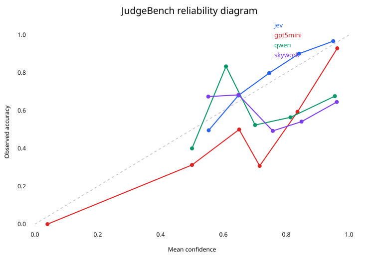
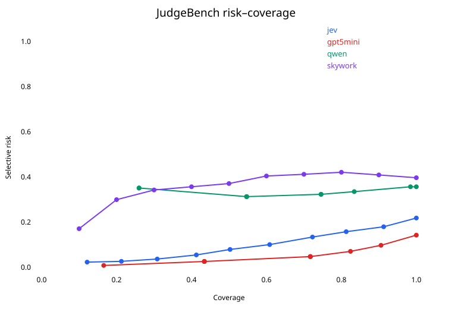

# Jev 类型决策模型在评估场景中的应用研究

> 状态：v1.0。已完成 JudgeBench GPT-4o split 的多模型全量双顺序实验、
> RewardBench 2 的 Jev 全量 ranking/rating 实验、bootstrap 统计、可靠性图和
> 定性错误审计。示例 smoke-test 不作为模型证据。

## 摘要

Jev 是一种面向类型化判断而非文本生成的托管决策模型。给定状态和问题，它
返回固定选项、命题概率或有序评分。本文研究的核心不是 Jev 是否“优于大模型”，
而是它在模型评估中何时能够成为可靠的 judge，以及它在准确率、校准、稳定性、
延迟与成本之间形成怎样的边界。研究将 Jev 与生成式 LLM judge、专用 reward
model、开放决策模型和简单基线放在统一协议下比较。

## 0. 本次到底跑了什么

截至 2026-11-10，仓库包含两套公开评估集合、六个完整实验 run，共 6,428 条
真实 API 或本地模型判断明细：

| Benchmark / 协议 | 原始样本 | 实际判断数 | 比较对象 | 主要问题 |
|---|---:|---:|---|---|
| JudgeBench pairwise + A/B swap | 350 对 | 700 × 4 模型 | Jev、GPT-5 mini、Qwen3-30B-A3B、Skywork RM 0.6B | 能否识别客观正确回答；是否受位置影响 |
| RewardBench 2 rating | 1,865 条 | 1,865 | Jev | 独立评分能否把 chosen 排在 rejected 之前 |
| RewardBench 2 ranking | 1,763 条非 Ties | 1,763 | Jev | 同时观察四个候选时能否选中最佳回答 |
| RewardBench 2 Ties | 102 条 / 51 组 | 包含在 rating 中 | Jev | 多个正确回答的分数间隔是否合理 |

这里的“6,428 条”是 `700×4 + 1,865 + 1,763`。完整实验结果总索引位于
[`artifacts/README.md`](../artifacts/README.md)。逐条结果并非外部链接或未提交的
本地文件，而是仓库中实际提交的 JSONL/CSV。

### 0.1 结果文件在哪里

- 四模型 JudgeBench 逐项对照：
  [`artifacts/comparisons/judgebench.csv`](../artifacts/comparisons/judgebench.csv)
- Jev JudgeBench 700 条：
  [`artifacts/runs/judgebench-jev-1.14/results.jsonl`](../artifacts/runs/judgebench-jev-1.14/results.jsonl)
- GPT-5 mini JudgeBench 700 条：
  [`artifacts/runs/judgebench-gpt-5-mini/results.jsonl`](../artifacts/runs/judgebench-gpt-5-mini/results.jsonl)
- Qwen JudgeBench 700 条：
  [`artifacts/runs/judgebench-qwen3-30b-a3b-v2/results.jsonl`](../artifacts/runs/judgebench-qwen3-30b-a3b-v2/results.jsonl)
- Skywork Reward 0.6B JudgeBench 700 条：
  [`artifacts/runs/judgebench-skywork-rm-0.6b-256/results.jsonl`](../artifacts/runs/judgebench-skywork-rm-0.6b-256/results.jsonl)
- RewardBench 2 rating 1,865 条：
  [`artifacts/runs/rewardbench2-jev-rating/results.jsonl`](../artifacts/runs/rewardbench2-jev-rating/results.jsonl)
- RewardBench 2 ranking 1,763 条：
  [`artifacts/runs/rewardbench2-jev-ranking/results.jsonl`](../artifacts/runs/rewardbench2-jev-ranking/results.jsonl)

每个 run 目录同时包含 `metrics.json`。JudgeBench run 还包含 `manifest.json`，记录
完整 resolved config、数据 hash、Python 版本、模型 ID 和计划调用数。

### 0.2 核心结果一览

JudgeBench 的四模型结果：

| 模型 | 逐次准确率 | 严格双顺序准确率 | 顺序一致率 | p50 | 总费用 |
|---|---:|---:|---:|---:|---:|
| GPT-5 mini | 85.71% | 80.57% | 89.71% | 14.16 s | $2.3001 |
| Jev 1.14 | 78.14% | 70.57% | 84.86% | 0.436 s | $0.0543 |
| Qwen3-30B-A3B | 64.29% | 40.00% | 51.43% | 1.19 s | $0.1128 |
| Skywork Reward 0.6B（256 tokens） | 60.29% | 60.29% | 100.00% | 10.28 s | 本地运行，API 成本 $0 |

RewardBench 2 官方数据上的 Jev 自定义适配结果：四选一 Choice 为 82.47%（仅五个
非 Ties 子集）；统一 rating top-1 77.91%，严格排序 77.75%，派生 pairwise
93.12%。这些数字都不是 RewardBench 2 官方 leaderboard 成绩。

## 0.3 数据集清单与数据形态

### JudgeBench

来源是 JudgeBench 官方 GPT-4o response split，冻结到官方仓库 commit
`e2c52c284e735e139b3daa61c206ee208f36c461`。转换文件为
[`data/benchmarks/judgebench-gpt.jsonl`](../data/benchmarks/judgebench-gpt.jsonl)，
SHA-256：`e93afb67adad4fa12d1f6f34cb07e82f760682497efe7c4fd6f6c3147d4a3851`。

350 个回答对的构成为：

| 来源 | 唯一回答对 |
|---|---:|
| MMLU-Pro | 154 |
| LiveBench | 154（Reasoning 98，Math 56） |
| LiveCodeBench | 42 |

每条数据包括问题、两个由同一 response model 生成的候选回答，以及基于客观正确性
的 `A`/`B` 标签。运行时把每条数据再交换一次候选顺序，因此每模型产生 700 条结果。

### RewardBench 2

完整 test split 位于
[`data/benchmarks/rewardbench2.jsonl`](../data/benchmarks/rewardbench2.jsonl)，
SHA-256：`6999c797b2fdb9ed2a1aeb1fec481ee64640bcaaea69fb3116f7c740e9c10895`。

| 子集 | 样本数 | 关注能力 |
|---|---:|---|
| Factuality | 475 | 事实正确性与幻觉 |
| Focus | 495 | 回答是否聚焦、相关和简洁 |
| Safety | 450 | 安全偏好与拒答质量 |
| Math | 183 | 数学答案/推理偏好 |
| Precise IF | 160 | 精确指令遵循 |
| Ties | 102 | 多个同等正确回答及 margin |

普通样本通常是一条 chosen 加三条 rejected。Ties 样本可能包含多个正确回答和更多
候选，因此不能强制改成简单 A/B 任务。

## 0.4 一条实验明细是什么样的

JudgeBench 明细保存 `item_id`、来源、原始/交换方向、gold label、模型选择、A/B
概率、实际模型版本、延迟、token usage、费用，以及完整请求与响应。例如某条 Jev
结果可能是 `label=B, choice=A, P(A)=0.58, P(B)=0.42`，这是一条明确的错误判断；
同一 `item_id` 的另一个 orientation 用于判断它是否还存在位置不一致。

RewardBench 2 rating 明细的 `scores` 顺序固定为 chosen 在前、rejected 在后，并
保存每个候选在五档 rubric 上的完整概率分布。Ranking 明细保存确定性 shuffle、
正确位置、选择位置以及 A/B/C/D 全概率。这使读者可以不用重新调用 API，直接重算
所有表格或检查某个失败案例。

## 0.5 复现命令

```bash
# 离线重算已有结果，不产生 API 费用
PYTHONPATH=src python -m jev_eval.cli analyze \
  --run-dir artifacts/runs/judgebench-jev-1.14
python scripts/analyze_rewardbench2_rating.py \
  --results artifacts/runs/rewardbench2-jev-rating/results.jsonl \
  --output /tmp/rb2-rating-metrics.json

# 有 OPENROUTER_API_KEY 时重新请求模型
PYTHONPATH=src python -m jev_eval.cli run \
  --config configs/experiments/judgebench_jev.toml
python scripts/run_rewardbench2_jev_rating.py \
  --data data/benchmarks/rewardbench2.jsonl \
  --output artifacts/runs/rewardbench2-jev-rating-rerun/results.jsonl
```

## 1. 研究问题

- RQ1：在 pairwise、binary 与 ordered-rubric 任务上，各类 judge 与可靠标签的
  一致性如何？
- RQ2：决策模型返回的概率是否在任务内和跨任务时保持校准？
- RQ3：候选顺序、rubric 改写、答案长度、格式和注入文本会造成多大影响？
- RQ4：将整体 rubric 拆成原子问题是否改善可靠性？
- RQ5：在相同质量约束下，模型的成本、延迟和 coverage 如何？
- RQ6：固定版本与 `latest` 别名随时间产生多大漂移？

## 2. Jev 已有应用图谱

公开材料中的应用大致分为以下类别。本节只描述已经公开出现的模式，不推断任何
特定企业或部门应该采用它们。

| 类别 | 典型决策 | Jev 承担的角色 |
|---|---|---|
| LLM-as-a-Judge | 两个回答哪个更好、是否符合 rubric | 类型化评委 |
| RAG 评估 | 回答是否被上下文支持、检索片段是否相关 | faithfulness/relevance gate |
| 模型与工具路由 | 选择模型、工具或推理强度 | 快速路由器 |
| Agent 监督 | 工具调用是否合理、任务是否完成 | 执行前后门禁 |
| 内容审核 | 是否出现某种受限行为或内容 | 多标签策略检查 |
| 数据分类与筛选 | 类别、匹配、排序、是否进入后续流程 | zero-shot decision layer |
| 软件质量检查 | 输出是否符合项目约定或自然语言规则 | 语义 lint/check |

当前应用讨论的共同点是：输出空间可预先定义、判断频繁、结果直接由软件消费。
这些案例能说明产品形态，但不能替代独立 benchmark；公开案例经常样本较小、由
作者挑选，且可能同时受益于 Jev 的低价与集成方自身产品。

## 3. 业界争议与待验证假设

1. **模型范式还是 zero-shot classifier 产品化？** 必须加入 NLI/classifier 和
   reward-model 基线，才能分离模型能力与 API 形态的价值。
2. **typed output 不等于语义正确。** 输出永远合法只能消除解析失败，不能证明
   判断正确或不会高置信犯错。
3. **二元原子判断与复杂 rubric 的差异。** 已有结果提示前者更有利，因此二者
   不能合并成一个平均分。
4. **校准不能从通用声明迁移到具体数据。** 阈值必须在目标分布的验证集上选择。
5. **公平比较并不简单。** Jev、LLM judge 和 reward model 的输入方式、联合比较
   方式与概率定义不同，报告需要同时给出统一任务结果和机制差异。

## 4. 已执行的 Benchmark 设计

本版本使用 JudgeBench 与 RewardBench 2。JudgeBench 对每个回答对执行 A/B 交换，
直接测量位置稳定性；RewardBench 2 同时执行四候选联合 Choice 与候选独立 Score，
测量协议敏感性。rubric 等义改写、长度扰动、prompt injection、参考答案消融和
中英文对照没有混入本次主实验，因此报告不声称覆盖这些鲁棒性问题；它们属于新的
预注册实验，而不是本版本的“未跑完尾项”。

## 5. 比较对象

- 固定版本 Jev 1.14；
- GPT-5 mini 与 Qwen3-30B-A3B 生成式 judge；
- Apache-2.0 的 Skywork-Reward-V2-Qwen3-0.6B 开放权重 reward model；
- 交换顺序一致性作为不依赖额外模型的结构性基线检查。

模型名单、请求模型 ID 和实际返回版本均在 run manifest 中冻结。`jev-latest`、随机
或长度启发式没有用于主结果，因为它们不能回答当前的固定版本 judge 比较问题。

## 6. 指标与统计

主指标包括 pairwise accuracy、严格双顺序 accuracy、Macro-F1、Spearman/Kendall
相关、Brier score、log loss、ECE、risk–coverage、p50/p95 latency、每千次判断
成本和输出/API 失败率。模型差值采用 paired bootstrap 置信区间；多类别结果必须
同时报告，不以单一平均排名替代失败分析。

## 7. 可复现性与限制

仓库保存 resolved config、数据 hash、请求 hash、原始响应、实际模型版本、usage、
成本和延迟。托管模型无法保证 bit-for-bit 重跑，因此“重新分析已发布响应”和
“重新调用当前 API”是两种不同的复现级别。公开原始响应前还需要确认数据集许可、
隐私和 provider 条款。

## 8. JudgeBench 首轮结果（2026-11-09）

本轮使用 JudgeBench 官方 GPT-4o response split，共 350 个回答对；每个回答对交换
A/B 顺序判断两次，共 700 次判断/模型。数据固定到官方仓库 commit
`e2c52c284e735e139b3daa61c206ee208f36c461`，转换后 SHA-256 为
`e93afb67adad4fa12d1f6f34cb07e82f760682497efe7c4fd6f6c3147d4a3851`。

| 模型 | 单方向准确率 | 严格双顺序准确率 | 顺序一致率 | Brier | ECE | p50 延迟 | p95 延迟 | 总成本 |
|---|---:|---:|---:|---:|---:|---:|---:|---:|
| GPT-5 mini | 85.71% | 80.57% | 89.71% | 0.1055 | 0.0715 | 14.16 s | 46.98 s | $2.3001 |
| Jev 1.14 | 78.14% | 70.57% | 84.86% | 0.1439 | 0.0410 | 0.436 s | 0.523 s | $0.0543 |
| Qwen3-30B-A3B | 64.29% | 40.00% | 51.43% | 0.2952 | 0.2590 | 1.19 s | 8.73 s | $0.1128 |
| Skywork Reward 0.6B（256 tokens） | 60.29% | 60.29% | 100.00% | 0.3040 | 0.2457 | 10.28 s | 11.21 s | 本地 $0 API 费 |

### 初步解读

GPT-5 mini 在质量指标上领先，但 Jev 的调用成本约为其 1/42，p50 延迟约为其
1/32。Jev 因此体现的不是“绝对最强 judge”，而是一条明显不同的质量—成本—延迟
工作点。Jev 的 ECE 较低，但校准结论只适用于这套数据与当前概率接口。

双顺序协议改变了结论：Jev 从逐次判断准确率 78.14% 降至严格样本准确率
70.57%；Qwen 从 64.29% 降至 40.00%。若只按一次调用统计，尤其容易高估存在位置
偏好的生成式 judge。GPT-5 mini 也不是完全顺序稳定，其严格准确率比逐次准确率低
5.14 个百分点。

开放权重 Skywork baseline 使用 CPU float32、本地 256-token 左侧截断。它对每个
回答独立打分，再用同一分数派生交换方向，因此 100% 顺序一致是架构与执行方式的
结果，不代表最高语义质量。其 60.29% 准确率明显低于 Jev；但这个数字不能冒充
Skywork 官方 full-context JudgeBench 成绩，因为短上下文会丢失长问题的开头。

类别结果显示 GPT-5 mini 在 LiveBench 和 LiveCodeBench 上优势较大，而 Jev 在
MMLU 来源样本上的逐次准确率略高（Jev 80.52%，GPT-5 mini 77.27%）。这一观察仍需
置信区间和逐例错误分析，不能据此宣称领域优势。

生成式 judge 还出现了一个协议层失败：初版 Qwen prompt 曾将“候选 A/B”误解为
原始多选题的答案字母并返回 `D`。严格 schema 和候选标签说明修复了输出合法性，
但不能消除其明显的位置偏好。typed decision API 在输出空间约束上具有实际工程
优势，但这不等价于语义判断更准确。

## 9. 预注册式判定原则

- 不使用 smoke-test 数据比较模型。
- 不因为某个模型在一个聚合分数领先，就宣称全面优越。
- 顺序交换冲突在严格指标中计错。
- 校准结论限定在相应数据分布。
- 复杂 rubric 与二元判断分开下结论。
- 价格与模型可用性注明测量日期。

## 10. 完成状态

- [x] 冻结数据集版本与许可证记录
- [x] 运行 Jev 固定版本
- [x] 运行两个生成式 judge 基线
- [x] RewardBench 2 全量 Jev 任务结构适配（非官方 leaderboard 复现）
- [x] RewardBench 2 全量 Jev 统一 rating 与派生 pairwise 分析
- [x] 接入开放 reward/decision model
- [x] 生成置信区间与可靠性图
- [x] 完成定性错误分析
- [x] 补充结果、讨论和结论

## 11. RewardBench 2 全量结果（2026-11-09）

RewardBench 2 共 1,865 条，包含 Factuality、Focus、Math、Precise IF、Safety 和
Ties。数据集、子集划分和正确答案来自官方公开数据，不是本项目构造的；本项目实现
的 judge 协议则是 Jev 适配，并非官方 leaderboard runner 的逐项复现。适配协议对
1,763 条非 Ties 样本确定性地
打乱四个候选，让 Jev Choice 选择最佳回答；102 条 Ties 样本使用独立 Score，按
官方的 ref/tied accuracy 与 margin 公式聚合。这里的 Score 是本项目自定义五档
rubric；官方 generative-RM rating prompt 使用 1--10 分，因此即便聚合公式相同，
结果也不能作为官方榜单分数。统一 rating 协议则对每条样本的所有
候选独立评分，并派生 top-1、严格排序与 pairwise 指标。

| 子集 | Jev Choice 适配 | Rating top-1 | Rating 严格排序 | 派生 pairwise |
|---|---:|---:|---:|---:|
| Factuality | 80.42% | 81.47% | 81.05% | 90.74% |
| Focus | 93.54% | 87.88% | 87.68% | 94.75% |
| Math | 72.68% | 77.60% | 77.60% | 87.07% |
| Precise IF | 50.63% | 55.63% | 55.63% | 73.13% |
| Safety | 87.78% | 66.44% | 66.44% | 74.22% |
| Ties | 97.91%（官方公式 + 自定义五档分数） | 99.02% | 99.02% | 99.98% |
| 研究性聚合 | 80.49%（自定义六子集等权宏平均） | 77.91% | 77.75% | 93.12% |

Ranking 共花费 `$0.16098`，平均调用延迟 446.6 ms；rating 共花费
`$0.19796`，平均调用延迟 475.2 ms。二者均锁定 Jev 1.14，并保存实际返回版本、
每个候选概率/分数、usage 与逐样本结果。

协议差异是实质性的。Safety 在联合四选一时达到 87.78%，独立 rating 只有
66.44%；Math 则从联合选择的 72.68% 上升到独立评分的 77.60%。这表明“哪个回答
最好”和“每个回答绝对质量是多少”不是可互换的问题。派生 pairwise 93.12% 也不应
被误称为 RewardBench 2 官方成绩，因为它改变了样本权重与决策上下文。

同理，80.49% 是本项目为便于观察而计算的六子集等权平均，不是官方 leaderboard
overall；五个非 Ties 子集按样本数合并后的四选一准确率是 82.47%。

Precise IF 在两种协议中都是最弱子集（50.63% / 55.63%），是本次错误分析识别出的
原子化 rubric 新实验首要对象。Ties 分数异常高，需进一步审计 Score 的离散化、
候选间分数间隔以及是否存在数据构造线索；本报告暂不将其解释为通用 tie 能力。

## 12. 统计不确定性

以原始回答对（350 个）为重采样单位进行 10,000 次 paired bootstrap，固定随机
种子 `20261109`。这样同一题的 original/swapped 两次判断始终一起抽样，避免伪造
独立样本量。

| 模型 | 逐次准确率 95% CI | 严格双顺序准确率 95% CI |
|---|---:|---:|
| GPT-5 mini | 85.71% [82.43%, 88.86%] | 80.57% [76.29%, 84.57%] |
| Jev 1.14 | 78.14% [74.29%, 81.86%] | 70.57% [65.71%, 75.14%] |
| Qwen3-30B-A3B | 64.29% [60.86%, 67.71%] | 40.00% [34.86%, 45.14%] |
| Skywork Reward 0.6B（256 tokens） | 60.29% [55.14%, 65.43%] | 60.29% [55.14%, 65.43%] |

成对差值同样按题重采样：Jev 相对 GPT-5 mini 为 -7.57 个百分点，95% CI
[-11.71, -3.43]；Jev 相对 Qwen 为 +13.86 个百分点，95% CI [10.00, 17.71]。
Jev 相对 Skywork 的差值为 +17.86 个百分点，95% CI [12.00, 23.71]。前三个主要
比较区间均未跨 0；Qwen 相对 Skywork 为 +4.00 点，95% CI [-1.43, 9.57]，不能据此
排除抽样噪声。这些结论仍不能外推到企业内部数据。



可靠性图进一步解释 ECE：Jev 的置信区间分布较平滑，高置信桶的实际正确率与置信度
接近；GPT-5 mini 的结果大量集中在 0.9--1.0，且中间置信桶样本很少；Qwen 在
0.9--1.0 桶的平均置信度约 95.5%，实际正确率只有 67.6%，表现出明显过度自信。



Risk--coverage 图按自报置信度从高到低接收判断，并把被接收部分的错误率定义为 risk。
它是描述性分析，不是在测试集上替业务选择阈值。为避免同置信度样本被任意切开，
曲线包含阈值处的全部 ties：Jev 在置信度至少 0.96 时覆盖 12.14%，risk 约 2.35%；
置信度至少 0.76 时覆盖 50.29%，risk 约 7.95%；全覆盖时为 21.86%。这给“低置信
升级”提供了实验依据，但实际阈值必须在独立的内部验证集上重新选择。

## 13. 定性错误审计

审计文件按模型列出最高置信错误及可回查的 item ID。Jev 的 153 个错误中有 18 个
选择置信度不低于 0.8；GPT-5 mini 为 100/78；Qwen 为 250/196。这个计数说明
“错误更少”和“错误时是否知道自己可能错了”是两件事：GPT-5 mini 准确率最高，
但它的错误往往仍给出很高的自报概率。

高置信失败集中显示三类机制：第一，MMLU-Pro 生物、健康、心理学等知识题中，两个
候选都引用了原题选项字母，judge 容易被流畅解释而非最终正确选项吸引；第二，
LiveBench 数学和约束推理需要重新执行推理，单看表达质量不够；第三，Qwen 的大量
original/swapped 冲突说明其错误不仅是知识不足，还包含位置敏感性。完整清单位于
[`artifacts/analysis/error-audit.md`](../artifacts/analysis/error-audit.md)，不是只展示
挑选后的成功案例。

## 14. 结论与决策含义

本实验支持一个有限但清晰的结论：Jev 不是最准确的 judge，但在 JudgeBench 上形成
了明显的低成本、低延迟、较好校准的工作点。若业务允许把低置信样本升级给更强模型
或人工，Jev 适合作为第一层筛选；若错误代价高、任务依赖复杂推理或精确指令遵循，
不能只因 typed output 合法或价格低就直接上线。

是否后训练 Jev 类型模型，不能由公开 benchmark 单独决定。更合理的门槛是：先把
内部目标写成可重复标注的有限输出空间，构建代表真实错误成本的盲测集，再比较
Jev、开放 reward model、生成式 judge 和规则基线的 risk--coverage 曲线。只有当
专用模型在目标 coverage 下同时满足质量、成本、延迟和可维护性要求，后训练才比
直接调用或规则系统更有价值。

## 参考资料

- [*Evaluating and Benchmarking the System One Model Jev*](https://arxiv.org/abs/2609.37647), arXiv:2609.37647.
- [*JEV vs. LLMs as Rubric Judges*](https://arxiv.org/abs/2609.29769), arXiv:2609.29769.
- [*JEV-as-a-Judge: Accept When Confident, Escalate When Unsure*](https://arxiv.org/abs/2609.26550), arXiv:2609.26550.
- [*RewardBench 2: Advancing Reward Model Evaluation*](https://arxiv.org/abs/2506.01937), arXiv:2506.01937.
- [*JudgeBench: A Benchmark for Evaluating LLM-Based Judges*](https://arxiv.org/abs/2410.12784), arXiv:2410.12784.
- [Skywork-Reward-V2-Qwen3-0.6B model card](https://huggingface.co/Skywork/Skywork-Reward-V2-Qwen3-0.6B).
- OpenRouter Decisions API and Jev tutorials, accessed 2026-11-09.

